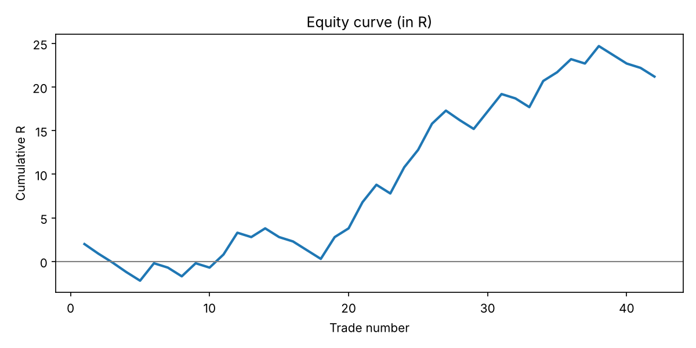

# Trade Journal Analyzer

A small Python tool that reads a CSV of your trades and tells you what the numbers actually say: win rate, expectancy, profit factor, drawdown, and which pairs, sessions and weekdays are helping or hurting you.

**The problem it solves:** most retail traders judge themselves by account balance alone, which hides *why* they win or lose. This tool converts every trade into an R-multiple (profit or loss as a multiple of the amount risked), so results are comparable across pairs and position sizes and patterns become visible.



## Quick start

```bash
pip install -r requirements.txt
python analyze.py sample_trades.csv --chart equity_curve.png
```

Run the tests with `pytest`.

## Your CSV

One row per closed trade, with these columns:

| Column | Example | Notes |
|---|---|---|
| `opened_at` | `2026-09-04 17:00` | Treated as UTC (used for session grouping) |
| `pair` | `EURUSD` | Any label you like |
| `direction` | `long` or `short` | |
| `entry` | `1.08831` | Entry price |
| `stop_loss` | `1.09041` | Your initial stop, which defines the risk |
| `exit` | `1.08411` | Exit price |

`sample_trades.csv` contains 42 **fictional** trades so you can try the tool right away. They are randomly generated and are not real results.

## What you get

- **Summary:** trade count, win rate, average win and loss, expectancy per trade, profit factor, total R, max drawdown, longest losing streak.
- **Breakdowns** by pair, session (Asian, London, London/NY overlap, New York), direction and weekday.
- **Equity curve** image with `--chart`.

Example output on the sample file:

```
=== Summary ===
Trades:                 42
Win rate:               47.6%
Average win:            +2.00R
Average loss:           -0.85R
Expectancy per trade:   +0.50R
Profit factor:          2.13
Max drawdown:           4.20R
```

## How R is calculated

```
risk = |entry - stop_loss|
R    = (exit - entry) * direction / risk      # direction: +1 long, -1 short
```

A trade that makes twice what you risked is +2R. A full stop-out is -1R.

## Limitations

- Fewer than about 30 trades is too small a sample to trust. The tool warns you when that's the case.
- Spreads, commissions and swaps are not modelled. Enter your actual exit price if you want them reflected.
- Session boundaries are rough UTC hour ranges, not exchange-exact.

## Ideas for next steps

- Import directly from a broker or MetaTrader export
- Add a notes/tags column (for example "news trade", "revenge trade") and break results down by tag
- A simple Streamlit dashboard
